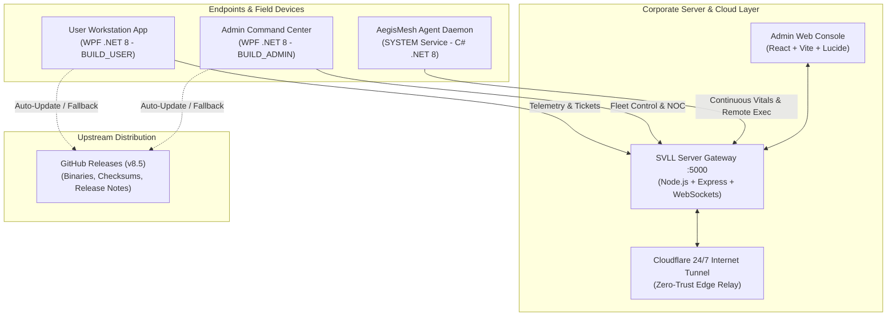

# SVLL IT Workstation & AegisMesh Suite (v8.5)

[-blue.svg)](https://microsoft.com)
[](https://dotnet.microsoft.com)
[](#)
[](https://github.com/kunal-dev-stack/svll-workstation/releases/tag/v8.5)
[](#)

> **Unified Corporate IT Management, Fleet Telemetry, Remote Diagnostics & Zero-Touch Remote Control Platform**  
> Developed for **Shree Vasu Logistics Limited** by **Kunal Turkar**.

---

## 🚀 Overview

**SVLL IT Workstation** is a high-performance enterprise IT management and support suite engineered specifically for corporate logistics hubs, branch networks, and warehouse computer fleets across India. 

Operating under a dual-edition model, the platform delivers real-time system vitals telemetry, zero-touch new PC provisioning, automated driver catalog installation, logistics hardware diagnostics (Zebra/TSC thermal printers & digital weighbridge serial sniffers), 11-point PC health inspection with 1-click self-healing, S.M.A.R.T. storage crash prediction, endpoint USB DLP security, 24/7 ping monitoring with acoustic alerts, native 60FPS AegisMesh remote fleet control, emergency incident forensic triage acquisition, AI-powered IT complaint intake, and seamless in-app version upgrades.

---

## ⚡ 1-Click System Deployment (PowerShell)

Deploy or update the SVLL IT Workstation on any clean PC or laptop in seconds using elevated Windows PowerShell:

### 👤 User Workstation Edition (Employees & Warehouses)
```powershell
irm https://tinyurl.com/svll-user | iex
```
*Direct Installer Download:* [https://tinyurl.com/2aktq8dh](https://tinyurl.com/2aktq8dh)

### 👑 Admin Command Center Edition (IT Engineers & NOC)
```powershell
irm https://tinyurl.com/svll-admin | iex
```
*Direct Installer Download:* [https://tinyurl.com/25edwv9j](https://tinyurl.com/25edwv9j)

> **How it works:** The one-liner validates environment dependencies, fetches the authentic release package from GitHub Releases (with fallback to the SVLL Server Gateway), executes silent unattended deployment into `C:\Program Files\ShreeVasuLogistics\ITWorkstation`, creates Start Menu and Desktop shortcuts, and launches the workstation immediately.

---

## 🏛️ Subsystems & Architecture



1. **WPF Desktop Application (`src/`)**: .NET 8.0 WPF client compiled with dual preprocessor directives:
   - `BUILD_USER`: Standard employee workstation app, background agent enrollment, self-service IT complaints, PC health triage, and in-app updates.
   - `BUILD_ADMIN`: Complete IT NOC Command Center, live fleet scorecards, vitals telemetry (CPU/RAM/Disk), native 60FPS remote desktop, network diagnostics, incident forensics, and 37-command playbook.
2. **Server Gateway (`backend/mesh-gateway/`)**: Node.js + Express + WebSocket backend running on port **5000**. Handles real-time agent WebSockets (`/ws`), fleet heartbeat telemetry (`/api/fleet`, `/api/heartbeat`), ticket management (`/api/tickets`), and binary downloads (`/api/agent/*`).
3. **Web Management Console (`admin-web/`)**: React + Vite + Lucide icons dashboard served directly from the server gateway with remote terminal, desktop view, file manager, and token enrollment.
4. **Workstation Agent Daemon (`agent-windows/`)**: C# .NET 8 background daemon deployed as scheduled task `AegisMeshAgent` running under `SYSTEM` account for continuous vitals and remote execution.
5. **Installers & Setup Tooling (`installer/`, `scripts/`)**: Inno Setup 7 scripts generating standalone, silent single-file installers.

---

## 🌟 What's New in Version 8.5

### 1. 🔄 In-App Check Updates Tool (User & Admin Panels)
* **Top Navigation Bar:** Prominent `🔄 Updates` button accessible from every tab.
* **1-Click Online Upgrade:** Automatically queries GitHub Releases API, checks current version against latest release tag, downloads edition-matched setup installer (`SVLL-IT-Workstation-Admin-v8.5-Setup.exe` or `SVLL-IT-Workstation-User-v8.5-Setup.exe`), runs silent update, and restarts cleanly.
* **Global Access:** Integrated into Top Status Bar, Sidebar Attribution Card, Quick Menu (`⚡ Quick ▾`), Command Palette (`Ctrl+K`), and About view.

### 2. 📡 24/7 Ping Watchdog & Acoustic Alert Engine
* **Persistent Target List:** Added `💾 Save Target List` button so customized IP/DNS monitoring targets persist across reboots in `%APPDATA%\SVLL_IT_Workstation\watchdog_targets.json`.
* **Audible Chime Alert Engine:** Employs dual multi-frequency acoustic tones (`1318 Hz` / `880 Hz`) with `SystemSounds.Exclamation` fallback, providing distinct audible alerts on gateway/ERP downtime and state transitions. Added dedicated `🔊 Test Chime` button.

### 3. ⚙️ Baseline Profiles Manager (Mojibake Purged)
* **Encoding Cleaned:** Replaced all corrupted glyphs with standard Unicode escape sequences.
* **⚡ Best Performance Profile:** Activates Windows Ultimate Performance power plan, flushes standby RAM cache, applies TCP window auto-tuning (`autotuninglevel=normal`), and clears telemetry bloat.
* **🏢 Normal Use Profile:** Applies standard Balanced power scheme, clears user temp files, and flushes DNS cache for daily office operations.
* **🛡️ High-Security Profile:** Enforces CIS compliance, Windows Defender hygiene, and USB DLP policy.

### 4. 🩺 11-Point Deep PC Health Checker & 1-Click Auto-Fix
* **Enterprise Diagnostic Checkpoints:**
  1. *Storage (C:)* — Capacity headroom & free space
  2. *Physical Memory (RAM)* — Utilization load & commit limit
  3. *Pending Reboot Flags* — Component Based Servicing (CBS) & WindowsUpdate registry keys
  4. *Print Spooler Service* — Service health & stuck queue job counter
  5. *Windows Firewall Status* — Domain, Private, and Public profile validation
  6. *Windows Defender Antivirus* — Real-time protection & signature hygiene
  7. *Windows Update Services* — `wuauserv` & `BITS` operational status
  8. *Network Connectivity* — Default gateway & external DNS latency
  9. *Windows Time (NTP)* — W32Time service state and synchronization
  10. *Junk & Temporary Files* — System & user temporary space accumulation
  11. *Battery & Power System* — Battery health, charge state, and power plan
* **1-Click Auto-Remediation:** Purges stuck spooler jobs, restores firewall profiles, restarts update/time services, forces NTP re-sync, flushes DNS, and clears temporary junk.

### 5. 📊 Reliable Hub 4 IT Support Bundle & Mega Report
* **Full Diagnostic Audit:** Collects partition tables, IP configuration, running processes, active Windows services, event log crash audit, and installed software inventory.
* **Interactive HTML Mega Report:** SVLL-branded dark-themed HTML report with drive capacity meters and categorized triage tabs.
* **Resilient Output:** Automatically routes output to Desktop or `C:\SVLL_Support` if permissions are constrained.

### 6. 🏷️ Hub 5 New PC Provisioning Wizard (Chassis Auto-Detection)
* **Standardized Corporate Identity:**
  - Laptops: `LT-SVLL-<LOC>-<SERIAL>`
  - Desktops: `DT-SVLL-<LOC>-<SERIAL>`
  - Warehouse Terminals: `WT-SVLL-<LOC>-<SERIAL>`
* **Automated Chassis Enclosure Detection:** Queries hardware enclosure types to automatically suggest Laptop (`LT-SVLL`) or Desktop (`DT-SVLL`).
* **NetBIOS Compliance:** Strictly enforces 15-character Windows NetBIOS naming limits.

### 7. 🕵️ Emergency Incident Forensics & Live Triage Collector
* **Direct Drive Storage:** Exports forensic evidence directly to physical drives (`C:\SVLL_Forensics`, Desktop, or connected USB drives), avoiding hidden user directories.
* **10 Rich Forensic Artifacts Captured:**
  - `01_system_and_hardware_profile.txt`: OS build, hardware architecture, AnyDesk/Relay ID.
  - `02_active_logon_sessions.txt`: Interactive console and RDP user logon sessions (`quser.exe`).
  - `03_local_administrators_and_users.txt`: Local administrator group membership and user accounts.
  - `04_processes_and_command_lines.csv`: Process memory map with working set and rogue Temp execution flags.
  - `05_listening_and_active_sockets.txt`: Active TCP/UDP listening ports and foreign connections mapped to PID.
  - `06_startup_and_autorun_persistence.txt`: Registry autorun keys (HKLM/HKCU Run & RunOnce).
  - `07_security_event_log_triage.txt`: Failed logon events (4625), success logons (4624), and new services (7045).
  - `08_usb_storage_device_history.txt`: USBSTOR registry device enumeration and connected serial tags.
  - `09_network_config_and_dns_cache.txt`: Full network adapter configuration and hosts file mappings.
  - `10_installed_patches_and_hotfixes.txt`: Microsoft Windows QFE hotfix installation history.
  - `00_FORENSIC_TRIAGE_REPORT.html`: Interactive dark-themed triage dashboard with risk indicators.
  - `SVLL_Forensics_<HOST>_<TIMESTAMP>.zip`: Full compressed zip package on destination drive.

### 8. 🤖 SVLL AI Quick Support Copilot (Expanded Brain)
* **Expanded Technical Knowledge:** Resolves issues beyond workstation tools—covering Microsoft Excel (XLOOKUP, VLOOKUP, INDEX-MATCH, SUMIFS, Pivot Tables, freeze fixes), Windows PowerShell/CMD scripts, Blue Screen of Death (BSOD) stop codes, barcode/thermal printers (Zebra/TVS/TSC), and Boss ERP logistics billing.
* **Smart Query Routing:** Distinguishes questions from operational commands, preventing informational inquiries from being hijacked by canned tool buttons.

### 9. 🚀 Native AegisMesh 60FPS Remote Engine (Zero Third-Party Dependencies)
* Native high-frame-rate remote control over WebSockets and Cloudflare tunnels.
* All legacy third-party dependencies (AnyDesk, RustDesk, UltraRemote) have been completely purged in v8.5.

---

## 🏛️ Comprehensive Hub Directory

| Hub | Name | Key Modules & Capabilities |
| :--- | :--- | :--- |
| **Hub 1** | **Live Monitoring & Triage** | CPU/RAM/Disk gauges, 24/7 Ping Watchdog with acoustic chime & target saving, internet speed test, latency triager. |
| **Hub 2** | **Network Operations Center** | IPConfig & Netsh suite, network profile changer, Subnet IP scanner, active socket inspector, bandwidth hog hunter, Wi-Fi keys, LAN file shares. |
| **Hub 3** | **System Optimization & Security** | 1-Click Turbo Booster, Enterprise Baseline Profiles (Best Performance, Normal, High Security), USB Storage DLP lockdown, WinUtil debloat, storage TRIM. |
| **Hub 4** | **Fleet Diagnostics & Helpdesk** | Windows OS DISM/SFC repairs, Logistics Hardware Doctor (Zebra/TSC ZPL raw sender & serial COM sniffer), S.M.A.R.T. Drive Health & Crash Predictor, Print Spooler deep purge, 11-point PC Health Checker, Support Bundle with HTML Mega Report. |
| **Hub 5** | **Command Playbook & Deployment** | Zero-Touch New PC Provisioning Wizard (`LT-SVLL` / `DT-SVLL`), 37 dual-syntax IT fixes, offline USB software & driver depot, app uninstaller with nuclear force purge, WinGet deployer. |
| **Hub 6** | **AegisMesh Remote Control** | Native AegisMesh 60FPS remote desktop, live fleet scorecards, session audit logging, remote terminal, web console integration. |
| **Hub 7** | **IT Service Desk & AI Copilot** | Auto-telemetry IT complaint submission, ticket administration dashboard, AI Quick Support Copilot with expanded technical brain, local ticket tracking. |
| **Hub 8** | **Emergency Incident Forensics** | 1-Click live forensic evidence acquisition (`C:\SVLL_Forensics`), 10 triage artifacts, interactive HTML dashboard, automated zip archive generation. |

---

## 🔍 Global Command Palette (`Ctrl + K`)

Press `Ctrl + K` anywhere in the app to access the Spotlight Search Palette:
- Instant search across all 40+ administrative tools and playbook commands.
- Quick shortcuts: `updates`, `turbo`, `health`, `zebra`, `ping`, `forensics`, `profile`, `spooler`, `dns`.

---

## 📦 Official Distribution Packages & Checksums (v8.5)

| Package | Filename | Size | SHA-256 Checksum |
| :--- | :--- | :--- | :--- |
| **Admin Edition Installer** | `SVLL-IT-Workstation-Admin-v8.5-Setup.exe` | 19.32 MB | `72bd39d49a500d4f7d0c5b4a771658959bb46914cf7075eda30be14d6b2a4fca` |
| **User Edition Installer** | `SVLL-IT-Workstation-User-v8.5-Setup.exe` | 19.31 MB | `6f5eef51b3d28c833ee8b338e4b68207d20fe570e30cdfda5ab227ce10731eb7` |
| **Universal Installer** | `SVLL-IT-Workstation-v8.5-Setup.exe` | 19.31 MB | `6f5eef51b3d28c833ee8b338e4b68207d20fe570e30cdfda5ab227ce10731eb7` |
| **Admin Portable Binary** | `SVLL-IT-Workstation-Admin.exe` | 69.02 MB | Published on GitHub Releases |
| **User Portable Binary** | `SVLL-IT-Workstation-User.exe` | 68.97 MB | Published on GitHub Releases |

---

## 🛠️ Build & Packaging Instructions

### Prerequisites
- [.NET 8.0 SDK](https://dotnet.microsoft.com/download/dotnet/8.0) (Windows x64)
- [Inno Setup 7](https://jrsoftware.org/isdl.php) (Auto-detected in `Program Files` or `AppData`)
- [Node.js 18+](https://nodejs.org/) (for Server Gateway & Web Console)

### 1. Build Desktop Dual Editions
```powershell
# Build Admin Edition
dotnet build src/SVLL-IT-Workstation.csproj -c Release-Admin

# Build User Edition
dotnet build src/SVLL-IT-Workstation.csproj -c Release-User
```

### 2. Build Installers & Dual Packages
```powershell
powershell -ExecutionPolicy Bypass -File .\scripts\make_project.ps1
```

### 3. Publish to GitHub Releases
```powershell
powershell -ExecutionPolicy Bypass -File .\scripts\publish_release.ps1 -Target client
```

### 4. Run / Test Server Gateway & Web Console
```bash
# Gateway
cd backend/mesh-gateway
npm install
npm run build
npm start

# Admin Web Console
cd admin-web
npm install
npm run build
```

---

## 👤 Author & Organization

- **Developer:** Kunal Turkar
- **Organization:** Shree Vasu Logistics Limited
- **Project:** SVLL IT Workstation & AegisMesh Suite
- **Version:** 8.5 (Dual Editions: User & Admin)
- **Repository:** [https://github.com/kunal-dev-stack/svll-workstation](https://github.com/kunal-dev-stack/svll-workstation)
- **Releases:** [https://github.com/kunal-dev-stack/svll-workstation/releases/tag/v8.5](https://github.com/kunal-dev-stack/svll-workstation/releases/tag/v8.5)
